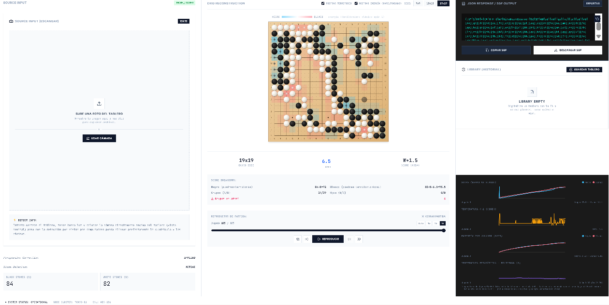

# KifuSnap — Kifu Board Scanner

Escanea la foto de un tablero de Go real, reconstruye la posición digital con visión por computadora clásica, y analiza la partida: puntuación, territorio, grupos, reproducción de partidas SGF jugada a jugada, y un conjunto de métricas físicas/informacionales (energía de un Hamiltoniano tipo Ising, temperatura estadística de Boltzmann, entropía de Shannon) que evolucionan en el tiempo mientras la partida se desarrolla.



## Tabla de contenidos

1. [Qué hace](#qué-hace)
2. [Stack técnico](#stack-técnico)
3. [Ejecutar en local](#ejecutar-en-local)
4. [Estructura del proyecto](#estructura-del-proyecto)
5. [Autores](#autores)

## Qué hace

### 1. De foto a posición digital

- **Corrección de perspectiva híbrida**: detección automática de las 4 esquinas del tablero (OpenCV.js + `jscanify`), con ajuste manual arrastrando las esquinas cuando la detección automática falla.
- **Detección de piedras por visión clásica** (sin IA): `cv.HoughCircles`, corrección de iluminación por estimación de fondo, discriminación sombra-vs-piedra por textura (respuesta de Laplaciano) y clasificación de intensidad estricta — negro es solo lo verdaderamente negro, no gris; las sombras son oscuras pero no forman grupos redondos ni compactos.

### 2. Motor de reglas de Go

- Grupos y libertades (flood fill sobre componentes conexas), territorio, ojos, puntuación por área (estilo chino) con komi configurable.

### 3. Reproducción de partidas (SGF)

- Parser SGF completo (tokenizador + descenso recursivo, no regex) — soporta partidas reales con variaciones, comentarios y pases.
- Reproductor jugada a jugada: play/pausa, paso a paso, scrubber, velocidad ajustable.
- Editor manual de tablero: colocar/quitar/cambiar piedras, tableros 9×9, 13×13 y 19×19, librería local de partidas guardadas.

### 4. Métricas de la evolución de la partida

Graficadas en vivo mientras se reproduce la partida:

| Métrica | Qué mide |
|---|---|
| **Score** | Negro vs. blanco, jugada a jugada. |
| **Temperatura (\|Δscore\|)** | Magnitud del cambio de score entre jugadas consecutivas: qué tan "caliente"/decisiva es cada jugada. |
| **Entropía de Shannon por jugador** | Entropía binaria de la fracción del tablero (piedras + territorio) que controla cada color, por separado para cada jugador. |
| **Campo de energía (Hamiltoniano clásico spin-1)** | Modelo tipo Ising portado de [Project-Quantum-Go](https://github.com/ometitlan/Project-Quantum-Go) (`cubic_interaction`), documentado en ese repo como el equivalente clásico exacto del valor esperado del Hamiltoniano cuántico. El tablero se pinta de azul/rosa con la energía local mientras la partida avanza. |
| **Temperatura estadística de Boltzmann (β)** | Temperatura de Jaynes/máxima entropía: la distribución de Boltzmann sobre los estados que el Hamiltoniano define en cada punto es la única que maximiza la entropía de Shannon sujeta a reproducir la energía real observada; β es el multiplicador de Lagrange de esa restricción. |

Las tres nociones de "temperatura" (`|Δscore|`, Boltzmann/β, y la de teoría de juegos combinatoria — CGT, mencionada pero no implementada) son deliberadamente distintas y no se confunden entre sí dentro de la app.

## Stack técnico

- **Frontend**: React 19 + Vite + TypeScript, Tailwind CSS v4.
- **Visión por computadora**: OpenCV.js (`@techstark/opencv-js`), `jscanify`.
- **Servidor**: Express + `tsx` (endpoint de escaneo por Gemini disponible pero no usado por el flujo principal, que corre 100% por CV clásica en el navegador).

## Ejecutar en local

**Requisitos:** Node.js

1. Instalar dependencias:
   ```
   npm install
   ```
2. (Opcional) Configurar `GEMINI_API_KEY` en [.env.local](.env.local) — solo necesario si se usa el endpoint de escaneo por IA, no para el flujo de CV clásica.
3. Levantar la app:
   ```
   npm run dev
   ```

## Estructura del proyecto

```
src/
  components/   # GoBoard, BoardScanner, CornerAdjuster, GamePlayer, GameChart, ...
  lib/          # OpenCV loader, detección de esquinas, warp de perspectiva
  utils/        # goAnalysis (reglas), sgf/sgfPlayback, stoneDetection (CV clásica),
                # hamiltonianEnergy, boltzmannTemperature
  types.ts
server.ts       # Express + endpoint dormante de escaneo vía Gemini
docs/           # Recursos del README (capturas, etc.)
```

## Autores

- **Leonardo Jiménez** — [metamatematico](https://github.com/metamatematico)
- **Mario Mercado** — [ometitlan](https://github.com/ometitlan)
